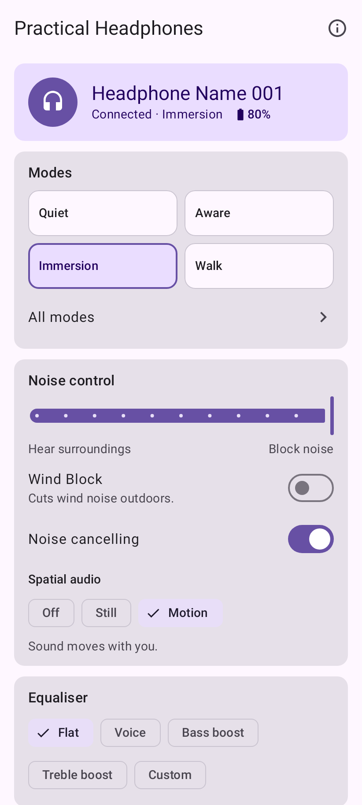
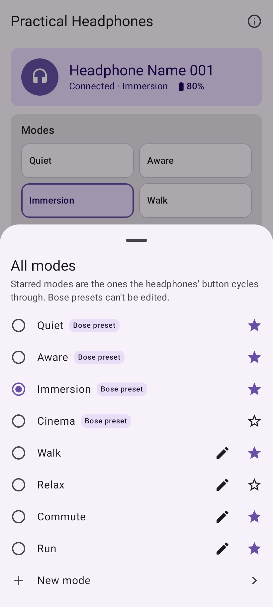
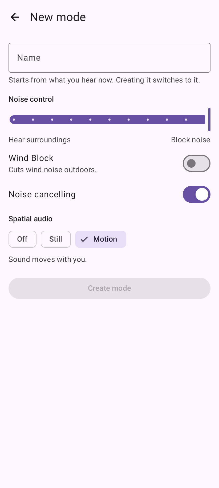

# Practical Headphones

[](https://github.com/Sargemck/practical_headphones/actions/workflows/check.yml)

Practical Headphones is a lightweight, zero-permission-creep Android app for controlling Bluetooth headphones directly over Classic Bluetooth (RFCOMM) and BLE GATT — no vendor account, no cloud sync, no background telemetry, and no `INTERNET` permission. Built and hardware-verified for the **Bose QuietComfort Ultra Headphones (2nd Gen)**, with experimental multi-brand support across **Bose**, **Sony**, **Anker Soundcore**, **Samsung Galaxy Buds**, **Nothing / CMF**, and **JBL**.

A Material You home screen widget, a Quick Settings tile, and an ongoing notification keep everyday controls one tap away, and optional Companion Device auto-connect makes the app ready the moment your headphones connect.

Not affiliated with Bose, Sony, Anker/Soundcore, Samsung, Nothing, or HARMAN/JBL. Bose and QuietComfort are trademarks of Bose Corporation. Sony is a trademark of Sony Group Corporation. Soundcore is a trademark of Anker Innovations Limited. Samsung and Galaxy Buds are trademarks of Samsung Electronics Co., Ltd. Nothing and CMF are trademarks of Nothing Technology Limited. JBL is a trademark of HARMAN International Industries, Incorporated.

| Main screen | All modes | New mode |
|---|---|---|
|  |  |  |

## Features

- **Modes (Bose):** switch presets, pick which modes the headphone button cycles through, and create, edit, or delete custom modes (new modes start from what you're currently hearing).
- **Noise control:** continuous 0–10 noise control, Wind Block, and spatial audio (Off, Still, Motion) on Bose Ultra models; discrete ANC / Ambient / Off modes, Ambient Sound slider, and Focus on Voice where supported.
- **Equaliser:** presets plus 3-band (Bose), 5-band + Clear Bass (Sony), or 8-band (Soundcore) custom equalisers.
- **Calls & voice:** Self Voice (sidetone), Speak-to-Chat (Sony), and auto answer.
- **Device & battery:** single or per-earbud (`L / R / Case`) battery readout, multipoint status, multi-headphone switcher, rename, pairing mode, and power off.
- **Quick Settings tile, Material You widget & ongoing notification:** one-tap mode / ANC cycling and live battery readout from anywhere on the phone.
- **Auto-connect, smart multi-pair auto-switch & offline view:** starts automatically when associated headphones connect (Android 16+), switches automatically to whichever paired headset is actively connected, and shows the last known settings dimmed when disconnected.
- **Privacy-safe diagnostics:** one-tap diagnostic report copy on the About screen with zero MAC addresses or personal device aliases.

## Install

Download the APK from [GitHub Releases](https://github.com/Sargemck/practical_headphones/releases). F-Droid is planned.

## Supported Headphones

- **Bose (Verified):** QuietComfort Ultra Headphones (2nd Gen) — hardware-verified on firmware 10.12.12.
- **Bose (Experimental):** QC Ultra Earbuds 2, QuietComfort Headphones (2023), QC45, QC35 / QC35 II, Ultra Open Earbuds.
- **Sony (Experimental):** WH-1000XM3, WH-1000XM4, WH-1000XM5, WH-1000XM6, WF-1000XM4, WF-1000XM5 (MDR v1/v2).
- **Anker Soundcore (Experimental):** Life Q30, Life Q35, Space Q45, Space One, Space 2, Liberty 4 / 4 NC.
- **Samsung (Experimental):** Galaxy Buds2, Buds2 Pro, Buds FE, Buds Live, Buds Pro.
- **Nothing / CMF (Experimental):** Nothing Ear, Ear (a), Ear (2), Headphone (1), CMF Headphone Pro, CMF Buds 2 (NT Link RFCOMM).
- **JBL (Experimental):** JBL Tune 230NC TWS, Wave Buds 2, and compatible `excelpoint` BLE GATT earbuds.

## Requirements

- Android 12 (API 31) or newer. Companion-device auto-connect requires Android 16 or newer.
- Supported headphones paired with the phone over Classic Bluetooth.
- Only one app can hold the RFCOMM control channel at a time. If an official companion app takes over the link, Practical Headphones detects contention rather than fighting for the socket and offers a one-tap **Reconnect**.

## Privacy

The app requests **no `INTERNET` permission** and includes zero analytics or crash-reporting SDKs. It reads and writes settings directly on your headphones over Bluetooth and stores only the last-seen settings in private no-backup app storage so they never leave the device. See [PRIVACY.md](PRIVACY.md).

## Architecture

The codebase is split into pure-JVM protocol modules and a thin Android shell:

| Module | Role |
|---|---|
| [`:bmap`](bmap/) | Pure Kotlin/JVM Bose BMAP frame codec, stream parser, 6-model catalog, and `FakeBmapDevice` simulator. |
| [`:sony`](sony/) | Pure Kotlin/JVM Sony MDR v1/v2 byte-stuffed codec, 1-bit ACK/sequence engine, NC/ASM & EQEBB protocol, and `FakeSonyDevice`. |
| [`:soundcore`](soundcore/) | Pure Kotlin/JVM Anker Soundcore packet codec, state-blob / ANC / 8-band EQ protocol, and `FakeSoundcoreDevice`. |
| [`:samsung`](samsung/) | Pure Kotlin/JVM Samsung Galaxy Buds SPP + CRC16-CCITT codec, extended status / ANC / EQ protocol, and `FakeSamsungDevice`. |
| [`:nothing`](nothing/) | Pure Kotlin/JVM Nothing / CMF NT Link + CRC16-MODBUS codec, battery / Adaptive ANC protocol, and `FakeNothingDevice`. |
| [`:jbl`](jbl/) | Pure Kotlin/JVM JBL BLE GATT + Fast Pair Message Stream parser, ANC / Ambient Aware / TalkThru protocol, and `FakeJblDevice`. |
| [`:app`](app/) | Android foreground service (`connectedDevice`), RFCOMM & BLE GATT transports, brand-agnostic `HeadphoneDriver` & optimistic `HeadphoneRepository`, Jetpack Compose + Material You UI, home screen widget, Quick Settings tile, and Roborazzi screenshot tests. |

- **Zero Android imports in protocol modules:** all wire framing, checksums, retries, and state machines are tested deterministically on the JVM against captured hardware fixtures and in-memory fake devices.
- **Battery-safe Bluetooth lifecycle:** RFCOMM connections are only opened when `SystemLinkMonitor` reports A2DP, HFP, or LE Audio connected — never polling or waking sleeping headphones in a bag.
- **Visual regression testing:** every screen and card is verified with Roborazzi golden screenshots across light theme, dark theme, and 200% font scale on every test run.
- Hardware protocol notes and firmware 10.12.12 findings are documented in [docs/FINDINGS.md](docs/FINDINGS.md).

## Building & Demo Mode

- Requires **JDK 21** and the **Android SDK** (`platforms;android-37.0`).
- Full check (JVM protocol tests, Robolectric UI + Roborazzi screenshot tests, Android Lint, debug APK):
  ```bash
  ./gradlew test lint assembleDebug
  ```
- Unsigned release APK (sign via gitignored `keystore.properties` with `storeFile`, `storePassword`, `keyAlias`, `keyPassword`):
  ```bash
  ./gradlew assembleRelease
  ```
- **Try without physical headphones (Debug Demo Mode):** install the debug build on any emulator or phone and launch against an in-memory simulated headset:
  ```bash
  ./gradlew installDebug
  adb shell am start -n io.github.sargemck.practicalheadphones/.MainActivity --ez demo true --es demoDevice qc_ultra2
  # Other simulated models: qc_ultra2_earbuds | qc45 | qc35 | sony_xm5 | soundcore_q45 | galaxy_buds2_pro | nothing_ear | jbl_tune230nc
  ```

## Credits

Protocol knowledge and ported logic come from open-source MIT projects:
- [bosectl](https://github.com/aaronsb/bosectl) — Aaron Bockelie (MIT)
- [SonyHeadphonesClient](https://github.com/Plutoberth/SonyHeadphonesClient) — Nir Harel, Mor Gal, Sem Visscher, jimzrt, guilhermealbm, and contributors (MIT)
- [soundcorebridge](https://github.com/mervin008/soundcorebridge) — Mervin (MIT)
- [omarchy-headphones](https://github.com/ncr/omarchy-headphones) — Jacek Becela (MIT)

Icons are Material Icons by Google (Apache License 2.0). Full notices in [NOTICE](NOTICE).

## Licence

MIT. See [LICENSE](LICENSE).
